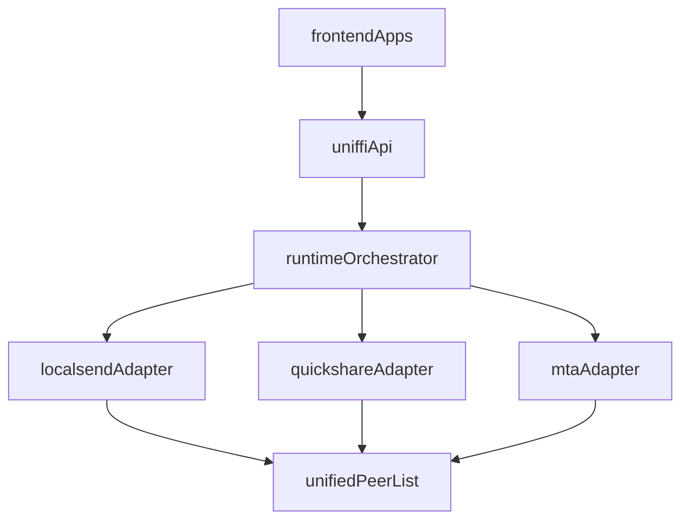

# Satella

Satella is a multi-protocol file sharing engine, written in Rust. One library
runs LocalSend, Google Quick Share (Nearby Share) and the Mutual Transfer
Alliance (MTA) **at the same time**, and exposes them as a single endpoint
that a frontend can consume.

The goal is simple: *share to anyone, regardless of which protocol they
speak*. A frontend talks to Satella once and never learns that three
different wire protocols are involved.



## What a frontend gets

- **One device list.** Every adapter discovers at the same time; the runtime
  merges their streams into one list. Each entry says which protocol it was
  found on.
- **One pending-transfer state.** An incoming transfer carries the protocol
  the *sender* used, so a frontend can badge the request ("LocalSend", "Quick
  Share", "MTA") and route the accept/reject to the right adapter without
  knowing the protocols themselves.
- **One send path.** A send is routed to the adapter that owns the target
  peer's protocol. The frontend just says "send this file to that peer".

## Layout

| Crate | What it is |
| --- | --- |
| `satella-core` | The protocol-neutral types (`Peer`, `Protocol`, `SendRequest`, `ReceivePending`, `TransferProgress`) and the `ProtocolAdapter` trait every protocol implements. |
| `satella-runtime` | Runs every adapter concurrently, merges their events, routes sends by protocol. |
| `satella-localsend` | LocalSend protocol v2 adapter. Engine forked from `localsend/localsend`. |
| `satella-quickshare` | Google Quick Share adapter. Engine forked from `Martichou/rquickshare`. |
| `satella-mta` | Mutual Transfer Alliance adapter. Engine forked from `Tinnci/cattysend`. |
| `satella-api` | The public surface: a UniFFI library described by `satella.udl`. |
| `satella-cli` | A terminal harness: discovery, send, receive. |

Adding a protocol means adding one adapter crate and one line to the
frontend's adapter list. Nothing in `satella-core` or `satella-runtime`
changes.

## Using it from a frontend

Satella is exposed through [UniFFI](https://mozilla.github.io/uniffi-rs/), so
one Rust library serves Kotlin (Android), Swift (Apple), and the desktop
bindings.

The contract lives in `crates/satella-api/src/satella.udl`:

```
interface Engine {
    constructor();
    sequence<string> start();
    sequence<Peer> peers();
    sequence<Peer> peers_for(Protocol protocol);
    EngineEvent? next_event();
    void send(Peer peer, sequence<string> file_paths);
    void accept(ReceivePending pending, string destination);
    void reject(ReceivePending pending);
    void stop();
};
```

Every `Peer` carries a `Protocol`, and so does every `ReceivePending` — that
is the whole point of the design.

## Using it from a terminal

```sh
# List the peers of every protocol, each row labelled with its protocol
cargo run -p satella-cli -- discover --seconds 30

# Send files to a peer, found by its fingerprint.
# MTA sends need a real Wi-Fi Direct group owner, which needs root on Linux;
# the other protocols work unelevated.
sudo cargo run -p satella-cli -- send <fingerprint> ./photo.jpg

# Accept incoming transfers into a directory
cargo run -p satella-cli -- receive ./downloads
```

The harness is the manual counterpart of the UniFFI surface: what it shows is
what a frontend sees.

## Building and checking

```sh
cargo fmt --all -- --check
cargo clippy --workspace --all-targets -- -D warnings
cargo test --workspace
cargo doc --workspace --no-deps
```

## Platform notes

- **Linux** is the first-class target. LocalSend uses UDP multicast and
  HTTPS; MTA uses BlueZ over BLE GATT, NetworkManager to join a group, and
  wpa_supplicant to create the Wi-Fi Direct group when sending; Quick Share
  uses mDNS.
- **Android** needs the BLE permissions and a foreground service for the
  background transfer, which is what the Android frontend shell owns. The
  library itself needs no platform-specific code.
- **Windows** is supported for the LocalSend and Quick Share paths. The MTA
  adapter needs a WinRT BLE implementation, which is not vendored yet.

MTA sending is the one part that needs `sudo`: wpa_supplicant's D-Bus API,
which creates the Wi-Fi Direct group owner that Android receivers require, is
root-only. It also needs `dnsmasq` on `PATH` to hand out addresses inside the
group. LocalSend and Quick Share need no elevated privileges.

## License

Satella is **GPL-3.0-or-later**.

This is not a choice — it follows from the code. The Quick Share engine is
forked from `rquickshare`, which is GPL-3.0, so Satella is a derivative work
and must be GPL-3.0-or-later. The Apache-2.0 LocalSend code and the MIT
cattysend code are compatible as inbound, and their copyright headers,
license texts and notices are preserved.

Each adapter crate carries a `THIRD_PARTY_NOTICES.md` naming the upstream
project and the exact commit it was forked from.

## Third-party origins

| Protocol | Upstream | License | Forked from |
| --- | --- | --- | --- |
| LocalSend | [localsend/localsend](https://github.com/localsend/localsend) | Apache-2.0 | `26cc8f997aa3f7ad789c12500a8b7206cfbb3ddc` |
| Quick Share | [Martichou/rquickshare](https://github.com/Martichou/rquickshare) | GPL-3.0 | `378d8ae969941bee4bf60ad34ac9cf8bb7005eb7` |
| MTA | [Tinnci/cattysend](https://github.com/Tinnci/cattysend) | MIT | `c0b2c757279c051c8f1ecc408462ac5a2d53dd8b` |

Only the protocol engines are forked. No application code (LocalSend's Flutter
front end, for instance) is copied, and no upstream code is relicensed.
