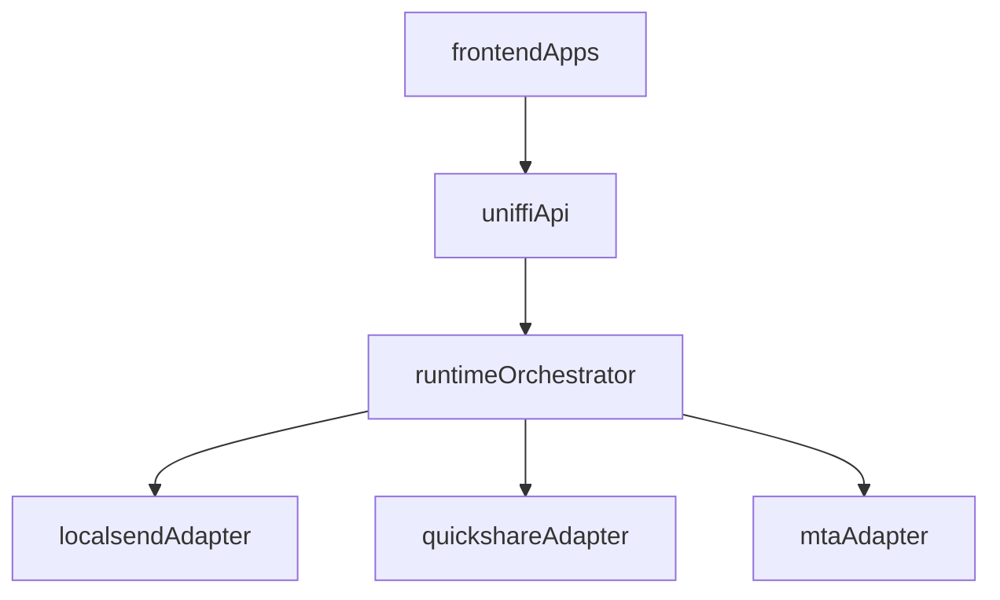

# Satella

Satella is a multi-protocol file sharing engine, written in Rust. One library
runs LocalSend, Google Quick Share (Nearby Share) and the Mutual Transfer
Alliance (MTA) **at the same time**, and exposes them as a single endpoint
that a frontend can consume.

The goal is simple: *share to anyone, regardless of which protocol they
speak*. A frontend talks to Satella once and never learns that three
different wire protocols are involved.



## What a frontend gets

- **One device list.** Every adapter discovers at the same time; the runtime
merges their streams into one list. Each entry says which protocol it was
found on.
- **One pending-transfer state.** An incoming transfer carries the protocol
the *sender* used, so a frontend can badge the request ("LocalSend", "Quick
Share", "MTA") and route the accept/reject to the right adapter without
knowing the protocols themselves.
- **One send path.** A send is routed to the adapter that owns the target
peer's protocol. The frontend just says "send this file to that peer".

## Protocols working state

### Linux

| Protocols   | Discovery | Advertisement | Send              | Receive |
| ----------- | --------- | ------------- | ----------------- | ------- |
| LocalSend   | Works     | Works         | Works             | Works   |
| Quick Share | Works     | Works         | Works             | Works   |
| MTA         | Works     | Works         | Partially (1) (2) | Works   |

1. Sending files via MTA requires root via `pkexec`
2. Requires Bluetooth pairing confirmation

## Layout

| Crate | What it is |
| --- | --- |
| `satella-core` | The protocol-neutral types (`Peer`, `Protocol`, `SendRequest`, `ReceivePending`, `TransferProgress`) and the `ProtocolAdapter` trait every protocol implements. |
| `satella-runtime` | Runs every adapter concurrently, merges their events, routes sends by protocol. |
| `satella-localsend` | LocalSend protocol v2 adapter. Engine forked from `localsend/localsend`. |
| `satella-quickshare` | Google Quick Share adapter. Engine forked from `Martichou/rquickshare`. |
| `satella-mta` | Mutual Transfer Alliance adapter. Engine forked from `Tinnci/cattysend`. |
| `satella-api` | The public surface: a UniFFI library described by `satella.udl`. |
| `satella-cli` | A terminal harness: discovery, send, receive. |

Adding a protocol means adding one adapter crate and one line to the
frontend's adapter list. Nothing in `satella-core` or `satella-runtime`
changes.

## Using it from a frontend

Satella is exposed through [UniFFI](https://mozilla.github.io/uniffi-rs/), so
one Rust library serves Kotlin (Android), Swift (Apple), and the desktop
bindings.

The contract lives in `crates/satella-api/src/satella.udl`:

```
interface Engine {
    constructor();
    sequence<string> start();
    sequence<Peer> peers();
    sequence<Peer> peers_for(Protocol protocol);
    EngineEvent? next_event();
    void send(Peer peer, sequence<string> file_paths);
    void accept(ReceivePending pending, string destination);
    void reject(ReceivePending pending);
    void stop();
};
```

Every `Peer` carries a `Protocol`, and so does every `ReceivePending` — that
is the whole point of the design.

## Using it from a terminal

```sh
# List the peers of every protocol, each row labelled with its protocol
cargo run -p satella-cli -- discover --seconds 30

# Send files to a peer, found by its fingerprint.
# MTA sends use a narrow root helper for the Wi-Fi Direct group owner; install
# it and the polkit action once (see "Platform notes"), then run unprivileged.
# The other protocols work unelevated.
cargo run -p satella-cli -- send <fingerprint> ./photo.jpg

# Accept incoming transfers into a directory
cargo run -p satella-cli -- receive ./downloads

# Run the engine in the background, so the device keeps receiving files
cargo run -p satella-cli -- daemon --dir ./downloads

# Report what the daemon is doing, and stop it
cargo run -p satella-cli -- status
cargo run -p satella-cli -- stop
```

The harness is the manual counterpart of the UniFFI surface: what it shows is
what a frontend sees.

### Daemon mode

`satella-cli daemon` starts the same engine as a detached background process.
It keeps every protocol adapter running, accepts incoming transfers into a
directory, and survives the terminal it was started from.

| Command | What it does |
| --- | --- |
| `daemon [--dir D] [--auto-accept] [--alias NAME]` | Start the background process. `--dir` is where the received files go (the download directory by default). `--auto-accept` takes every transfer without asking. `--alias` is the name this device announces itself with. |
| `status` | Report whether the daemon runs, which peers it sees and which transfers it handled. |
| `stop` | Ask the daemon to stop, and remove its files. |

The daemon asks before it takes a transfer. Every incoming transfer shows up
as a desktop notification with an **Accept** and a **Refuse** button; the
click decides what happens, and the sender is answered accordingly. The
notification is the FreeDesktop Desktop Notifications Specification, so it
looks like every other notification on the desktop.

The daemon does not time the question out. The sender waits for the answer
and gives up on its own terms, and the notification comes down when the
transfer ends, so a question that nobody answers dies with the transfer it
was about.

`--auto-accept` turns the asking off: every transfer is taken as soon as it
arrives. That is the flag to use on a machine without a session bus, where
there is no notification to show in the first place. The daemon takes the
transfers itself when it cannot reach the notification bus at all.

The daemon keeps three files in `~/.cache/satella-cli/`:

| File | What it holds |
| --- | --- |
| `satella-cli.pid` | The process id of the daemon, when it started, and where it writes the files. |
| `satella-cli.state.json` | The peers of every protocol and the transfers the daemon handled. |
| `satella-cli.log` | The log of the daemon. `RUST_LOG` still applies. |

`status` and `stop` read the pid file and check that the process is really
there, so a daemon that died does not leave the commands claiming it is up.
The daemon runs as the user who started it; MTA sends still go through
`satella-mta-helper` as described in "Platform notes".

## Building and checking

```sh
cargo fmt --all -- --check
cargo clippy --workspace --all-targets -- -D warnings
cargo test --workspace
cargo doc --workspace --no-deps
```

## Platform notes

- **Linux** is the first-class target. LocalSend uses UDP multicast and
HTTPS; MTA uses BlueZ over BLE GATT, NetworkManager to join a group, and
wpa_supplicant to create the Wi-Fi Direct group when sending; Quick Share
uses mDNS.
- **Android** needs the BLE permissions and a foreground service for the
background transfer, which is what the Android frontend shell owns. The
library itself needs no platform-specific code.
- **Windows** is supported for the LocalSend and Quick Share paths. The MTA
adapter needs a WinRT BLE implementation, which is not vendored yet.

MTA sending is the one part that needs privilege: wpa_supplicant's D-Bus API,
which creates the Wi-Fi Direct group owner that Android receivers require, is
root-only. The CLI itself stays an ordinary user process. It calls
`satella-mta-helper` through `pkexec`; the helper performs only the fixed
create/destroy operations, and the packaged polkit action grants the local
`wheel` user a permanent authorization so there is no password prompt after
the one-time install:

```sh
cargo build -p satella-cli -p satella-mta-helper
sudo install -m755 target/debug/satella-mta-helper /usr/libexec/satella-mta-helper
sudo install -m644 packaging/org.satella.mta.policy /usr/share/polkit-1/actions/
sudo install -m644 packaging/60-satella-mta.rules /etc/polkit-1/rules.d/
```

`dnsmasq` must be installed to hand out addresses inside the group. Running
Satella as root still uses the in-process path (and the hardware probes use
it). A `cargo`-built CLI finds the debug helper next to itself first; set
`SATELLA_MTA_HELPER=/usr/libexec/satella-mta-helper` to use the installed,
permanently authorized helper. LocalSend and Quick Share need no elevated
privileges.

## License

Satella is **GPL-3.0-or-later**.

This is not a choice — it follows from the code. The Quick Share engine is
forked from `rquickshare`, which is GPL-3.0, so Satella is a derivative work
and must be GPL-3.0-or-later. The Apache-2.0 LocalSend code and the MIT
cattysend code are compatible as inbound, and their copyright headers,
license texts and notices are preserved.

Each adapter crate carries a `THIRD_PARTY_NOTICES.md` naming the upstream
project and the exact commit it was forked from.

## Third-party origins

| Protocol | Upstream | License | Forked from |
| --- | --- | --- | --- |
| LocalSend | [localsend/localsend](https://github.com/localsend/localsend) | Apache-2.0 | `26cc8f997aa3f7ad789c12500a8b7206cfbb3ddc` |
| Quick Share | [Martichou/rquickshare](https://github.com/Martichou/rquickshare) | GPL-3.0 | `378d8ae969941bee4bf60ad34ac9cf8bb7005eb7` |
| MTA | [Tinnci/cattysend](https://github.com/Tinnci/cattysend) | MIT | `c0b2c757279c051c8f1ecc408462ac5a2d53dd8b` |

Only the protocol engines are forked. No application code (LocalSend's Flutter
front end, for instance) is copied, and no upstream code is relicensed.
